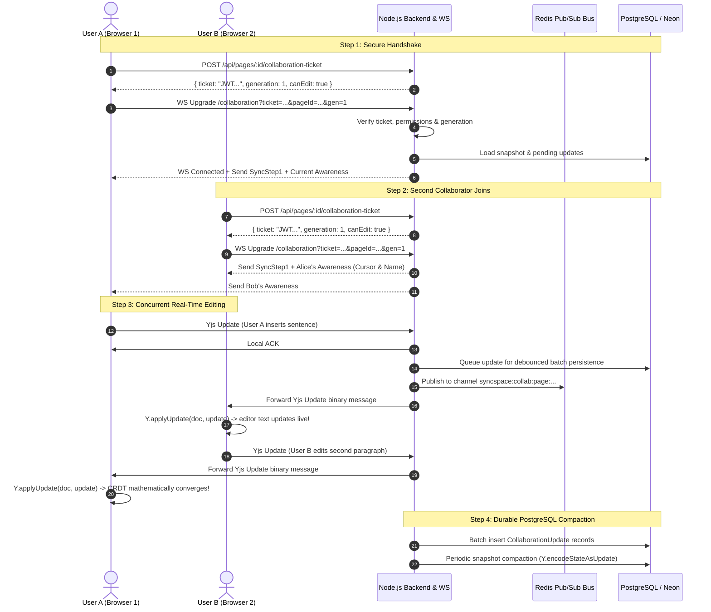

# SyncSpace (FS-02) — Real-Time Collaboration Flow

---

## 1. Sequence Diagram: Collaboration Handshake & Editing

---

## 2. Reconnection & Offline Handling

When a user temporarily loses connectivity:
1. Local edits are buffered inside the client's in-memory `Y.Doc`.
2. The `useCollaboration` hook detects the drop and switches the status badge to `Reconnecting...`.
3. Exponential backoff kicks in (1s, 2s, 4s, up to 10s).
4. Upon reconnection:
   - Client requests a fresh ticket.
   - Client sends its current `stateVector` via `SyncStep1`.
   - Server returns only the delta updates that occurred while the client was offline.
   - Client transmits any buffered local updates to the server.
   - The document converges instantly with zero manual merge prompts!
