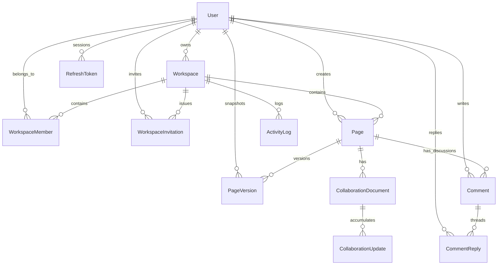

# SyncSpace (FS-02) — Database Schema Documentation

**Database:** PostgreSQL 16 / Neon Serverless PostgreSQL  
**ORM:** Prisma 6.19.3  

---

## 1. Entity-Relationship Diagram

---

## 2. Models Detail

### `User`
| Field | Type | Attributes | Description |
|---|---|---|---|
| `id` | String | PK, uuid | Unique identifier |
| `email` | String | Unique, Indexed | User email |
| `passwordHash` | String | - | bcrypt salt 12 hashed password |
| `name` | String | - | Full name |
| `avatarUrl` | String? | Optional | Profile image URL |
| `cursorColor` | String | Default '#3b82f6' | Hex color for live cursor |
| `createdAt` | DateTime | Default now() | Account creation timestamp |
| `updatedAt` | DateTime | UpdatedAt | Last update timestamp |

### `Workspace`
| Field | Type | Attributes | Description |
|---|---|---|---|
| `id` | String | PK, uuid | Unique workspace ID |
| `name` | String | - | Workspace title |
| `description` | String? | Optional | Brief description |
| `ownerId` | String | FK User, Cascade | Workspace creator |
| `createdAt` | DateTime | Default now() | Creation time |
| `updatedAt` | DateTime | UpdatedAt | Modification time |

### `WorkspaceMember`
| Field | Type | Attributes | Description |
|---|---|---|---|
| `id` | String | PK, uuid | Membership ID |
| `workspaceId` | String | FK Workspace, Cascade | Target workspace |
| `userId` | String | FK User, Cascade | Member user |
| `role` | Role | Default EDITOR | OWNER, ADMIN, EDITOR, COMMENTER, VIEWER |
| `joinedAt` | DateTime | Default now() | Date joined |

*Constraint:* Unique index `@@unique([workspaceId, userId])` enforces 1 role per user per workspace.

### `WorkspaceInvitation`
| Field | Type | Attributes | Description |
|---|---|---|---|
| `id` | String | PK, uuid | Invitation ID |
| `workspaceId` | String | FK Workspace, Cascade | Target workspace |
| `inviterId` | String | FK User, Cascade | Inviting member |
| `email` | String | Indexed | Invitee email |
| `tokenHash` | String | Unique, Indexed | SHA-256 hash of random invite secret |
| `role` | Role | Default EDITOR | Target role upon joining |
| `status` | InvitationStatus | Default PENDING | PENDING, ACCEPTED, REVOKED, EXPIRED |
| `expiresAt` | DateTime | - | Expiration (7 days default) |
| `createdAt` | DateTime | Default now() | Timestamp |

### `Page`
| Field | Type | Attributes | Description |
|---|---|---|---|
| `id` | String | PK, uuid | Document page ID |
| `workspaceId` | String | FK Workspace, Cascade | Owning workspace |
| `title` | String | Default "Untitled" | Document title |
| `icon` | String? | Default "📄" | Emoji icon |
| `order` | Int | Default 0 | Sidebar sorting order |
| `createdById` | String | FK User, Restrict | Creator |
| `lastEditedById` | String? | FK User, SetNull | Last editor |
| `collaborationGeneration` | Int | Default 1 | CRDT Generation counter |
| `isArchived` | Boolean | Default false | Soft delete state |
| `createdAt` | DateTime | Default now() | Creation time |
| `updatedAt` | DateTime | UpdatedAt | Modification time |

### `CollaborationDocument`
| Field | Type | Attributes | Description |
|---|---|---|---|
| `id` | String | PK, uuid | Collab document record ID |
| `pageId` | String | FK Page, Cascade | Target page |
| `generation` | Int | Default 1 | Collaboration generation |
| `snapshot` | Bytes | BYTEA | Full compacted Yjs binary snapshot |
| `stateVector` | Bytes? | Optional BYTEA | Cached Yjs state vector |
| `createdAt` | DateTime | Default now() | First initialized |
| `updatedAt` | DateTime | UpdatedAt | Last compacted snapshot time |

*Constraint:* `@@unique([pageId, generation])` isolates CRDT states across restores.

### `CollaborationUpdate`
| Field | Type | Attributes | Description |
|---|---|---|---|
| `id` | String | PK, uuid | Update entry ID |
| `documentId` | String | FK CollaborationDocument, Cascade | Parent document |
| `updateData` | Bytes | BYTEA | Raw binary incremental Yjs update |
| `createdAt` | DateTime | Default now() | Timestamp of update |

### `PageVersion`
| Field | Type | Attributes | Description |
|---|---|---|---|
| `id` | String | PK, uuid | Snapshot milestone ID |
| `pageId` | String | FK Page, Cascade | Page reference |
| `generation` | Int | - | Generation at time of snapshot |
| `name` | String | - | Milestone title |
| `description` | String? | Optional | Release or change notes |
| `snapshot` | Bytes | BYTEA | Complete restorable Yjs state |
| `createdById` | String | FK User | Creator of snapshot |
| `restoredFromId` | String? | Optional | Parent version if restored |
| `createdAt` | DateTime | Default now() | Snapshot creation time |

### `Comment` & `CommentReply`
- `Comment`: `id`, `pageId`, `authorId`, `content`, `anchor` (Json `{from, to, quote}`), `isResolved`, `resolvedById`, `resolvedAt`, `createdAt`, `updatedAt`.
- `CommentReply`: `id`, `commentId`, `authorId`, `content`, `createdAt`, `updatedAt`.

### `RefreshToken`
- `id`, `userId`, `tokenHash` (SHA-256), `expiresAt`, `revoked`, `replacedByToken`, `createdAt`.
